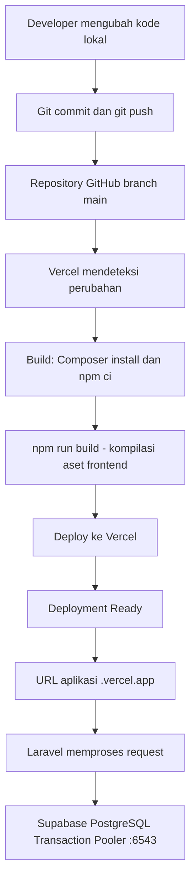

# Panduan Pengerjaan Praktikum Modul VII

**Proyek:** Sistem Perpustakaan Digital  
**NIM:** 250441100045  
**Materi:** SPA, CI/CD, dan Deployment Aplikasi

Panduan ini melanjutkan proyek Modul 1–6 yang sudah ada. Fitur Blade, Fetch API, autentikasi, role/permission, dan Policy peminjaman tetap dipertahankan; tugas Modul VII tidak meminta proyek diubah menjadi SPA.

> **Penting:** file `.env` hanya untuk komputer lokal dan tidak boleh di-commit atau diunggah ke Vercel. Gunakan `.env.example` sebagai contoh. Isi kredensial Supabase/Vercel milik sendiri, jangan menyalin placeholder secara literal.

## Persiapan sebelum menjalankan proyek

Paket source code yang disediakan tidak menyertakan folder `vendor`, `node_modules`, file `.env`, database SQLite lokal, maupun log/cache hasil running. Setelah mengekstrak ZIP, jalankan perintah berikut dari folder proyek:

```powershell
composer install
npm ci
npm run build
```

Jika belum memiliki `.env`, buat dari template dan hasilkan APP_KEY:

```powershell
Copy-Item .env.example .env
php artisan key:generate
```

Jika `.env` lama masih ada, jangan menimpanya. Pertahankan APP_KEY yang sudah digunakan, lalu ubah nilai koneksi database dan password seed sesuai petunjuk Soal 2.

## Perbaikan yang sudah diterapkan pada proyek

1. Ditambahkan `.env.example` berisi nama variabel aplikasi tanpa nilai rahasia, dengan contoh konfigurasi Supabase Session Pooler.
2. Ditambahkan opsi `PDO::ATTR_EMULATE_PREPARES` pada koneksi PostgreSQL untuk penggunaan Supabase Transaction Pooler.
3. Ditambahkan `api/index.php`, `vercel.json`, dan `.vercelignore` untuk deployment Vercel.
4. Ditambahkan Composer script `vercel` untuk menjalankan `npm ci` dan `npm run build` pada tahap build Vercel.
5. Ditambahkan aturan routing agar aset `/build`, `/css`, dan `/js` tetap dilayani sebagai file statis.
6. Duplikasi route DELETE buku dihapus. Route uji error Modul 6 hanya tersedia di lingkungan `local`/`testing`, bukan production.
7. NIM `250441100045` ditambahkan pada halaman login sebagai perubahan kecil untuk pengujian deployment otomatis Soal 5.
8. Email akun pada README disamakan dengan email yang benar-benar dibuat oleh `UserSeeder`.

## Soal 1 — Persiapan Proyek dan Repositori GitHub

### A. Periksa aplikasi lokal

Jalankan Laragon, pastikan database Modul 6 yang berisi data masih tersedia, lalu buka proyek:

```powershell
cd C:\laragon\www\perpustakaan_250441100045x
php artisan serve
```

Periksa halaman login, daftar buku, dan fitur peminjaman. Jangan menjalankan `migrate:fresh` pada database yang sudah berisi data penting.

### B. Pastikan file rahasia tidak masuk GitHub

File `.gitignore` sudah mengabaikan `.env`, file `.env.*`, `vendor`, `node_modules`, dan direktori `.vercel`, serta tetap mengizinkan `.env.example`.

Contoh potongan `.gitignore`:

```gitignore
/.env
/.env.*
!/.env.example
/node_modules
/vendor
/.vercel
```

Fungsi `.env` adalah menyimpan konfigurasi lokal dan nilai rahasia seperti APP_KEY serta password database. File tersebut tidak boleh di-commit agar kredensial tidak bocor. `.env.example` menjadi template nama variabel yang diperlukan oleh developer lain tanpa menyertakan rahasia.

### C. Buat dan hubungkan repository GitHub

Buat repository kosong di GitHub, lalu dari folder proyek jalankan:

```powershell
git init
git branch -M main
git add .
git status
git commit -m "Soal 1: persiapan proyek dan repository"
git remote add origin https://github.com/USERNAME/NAMA-REPOSITORY.git
git push -u origin main
```

Ganti URL remote dengan repository milik sendiri. Sebelum commit, pastikan `git status` tidak menampilkan `.env`.

**Screenshot laporan:** halaman login lokal, daftar buku lokal, potongan `.gitignore`, isi `.env.example`, dan halaman repository GitHub yang menunjukkan daftar berkas serta URL repository.

## Soal 2 — Menyiapkan Database Supabase

### A. Buat database Supabase

Buat project PostgreSQL di Supabase. Buka **Connect**, lalu salin informasi **Session pooler** untuk penggunaan lokal: host, port `5432`, dan username `postgres.<project-ref>`.

### B. Aktifkan ekstensi PostgreSQL pada PHP Laragon

Jalankan `php --ini` untuk mengetahui file `php.ini` yang aktif. Buka file tersebut dan aktifkan baris berikut dengan menghapus tanda `;` di depannya:

```ini
extension=pdo_pgsql
extension=pgsql
```

Restart terminal dan service Laragon. Pastikan ekstensi terdeteksi:

```powershell
php -m | findstr pgsql
```

### C. Atur `.env` lokal

Salin `.env.example` menjadi `.env` jika file `.env` belum ada. Isi koneksi database lokal menggunakan data **Session pooler** dari Supabase:

```env
DB_CONNECTION=pgsql
DB_HOST=aws-0-REGION.pooler.supabase.com
DB_PORT=5432
DB_DATABASE=postgres
DB_USERNAME=postgres.PROJECT_REF
DB_PASSWORD="PASSWORD_DATABASE_SUPABASE"
DB_SSLMODE=require
SESSION_DRIVER=database
```

Ganti `REGION`, `PROJECT_REF`, dan password menggunakan nilai dari project Supabase sendiri. Jika password mengandung karakter khusus seperti `#` atau spasi, gunakan tanda kutip pada `.env`.

**Perhatian:** seeder proyek memvalidasi `SEED_ADMIN_PASSWORD` minimal 12 karakter. `.env` yang diunggah bersama proyek sebelumnya berisi nilai yang terlalu pendek. Ganti ketiga nilainya dengan password pribadi yang kuat sebelum menjalankan seeder. Saat memakai PostgreSQL/Supabase, seeder meminta password Petugas dan Siswa minimal 12 karakter agar akun demo tidak dibuat dengan password umum `password`.

```env
SEED_ADMIN_PASSWORD=PASSWORD_ADMIN_PRIBADI_MINIMAL_12_KARAKTER
SEED_PETUGAS_PASSWORD=PASSWORD_PETUGAS_PRIBADI_MINIMAL_12_KARAKTER
SEED_SISWA_PASSWORD=PASSWORD_SISWA_PRIBADI_MINIMAL_12_KARAKTER
```

Jangan memakai contoh di atas sebagai password sebenarnya. Setelah mengatur variabel tersebut, jalankan `php artisan config:clear` sebelum seeder. Saat menggunakan Supabase, seeder memperbarui password akun demo agar password lama yang umum tidak tetap aktif.

### D. Jalankan koneksi, migrasi, dan seeder

```powershell
php artisan config:clear
php artisan db:show
php artisan migrate
php artisan db:seed
```

`db:show` harus menunjukkan driver `pgsql`. Setelah migrasi dan seeder selesai, periksa **Table Editor** Supabase dan pastikan tabel proyek serta data hasil seeder tersedia. `DatabaseSeeder` juga menjalankan `Modul6TestSeeder` setelah `UserSeeder` untuk menyiapkan transaksi milik masing-masing akun siswa sebagai data uji Policy/IDOR. Tes login aplikasi lokal menggunakan akun hasil seeder.

Jika database Supabase sudah berisi data, jangan menggunakan `migrate:fresh` karena perintah tersebut menghapus seluruh tabel.

### E. Penjelasan untuk laporan

Session Pooler menggunakan port `5432` dan cocok untuk koneksi aplikasi lokal yang berjalan secara terus-menerus. Transaction Pooler menggunakan port `6543` dan cocok untuk lingkungan serverless seperti Vercel karena mengelola koneksi singkat dari fungsi yang sering dibuat ulang. Opsi `PDO::ATTR_EMULATE_PREPARES` mengaktifkan emulasi prepared statement agar kompatibel dengan Transaction Pooler.

**Screenshot laporan:** keluaran `php artisan db:show`, Table Editor yang memperlihatkan daftar tabel dan isi tabel `users`, serta halaman aplikasi lokal yang berhasil login dan menampilkan data Supabase. Pada source code laporan, tampilkan bagian `.env` tanpa APP_KEY/DB_PASSWORD dan bagian `config/database.php`.

Commit perubahan konfigurasi database dan keamanan akun seed: 

```powershell
git add config/database.php config/app.php database/seeders/DatabaseSeeder.php database/seeders/UserSeeder.php .env.example README.md
git commit -m "Soal 2: konfigurasi database Supabase"
git push
```

## Soal 3 — Berkas Konfigurasi Vercel

Berkas berikut sudah dibuat pada proyek:

### `api/index.php`

```php
<?php

// Vercel forwards application requests to Laravel's public entry point.
require __DIR__ . '/../public/index.php';
```

Fungsinya menjadi pintu masuk request Vercel dan meneruskannya ke entry point Laravel.

### `vercel.json`

```json
{
  "version": 2,
  "functions": {
    "api/index.php": {
      "runtime": "vercel-php@0.9.0"
    }
  },
  "routes": [
    { "src": "/build/(.*)", "dest": "/build/$1" },
    { "src": "/css/(.*)", "dest": "/css/$1" },
    { "src": "/js/(.*)", "dest": "/js/$1" },
    { "src": "/(favicon\\.ico|robots\\.txt)", "dest": "/$1" },
    { "src": "/(.*)", "dest": "/api/index.php" }
  ]
}
```

Fungsinya memilih runtime PHP untuk `api/index.php`, meneruskan aset statis ke file yang sesuai, dan mengarahkan request halaman lain ke Laravel. Runtime `vercel-php@0.9.0` mengikuti contoh runtime pada modul dan masih tercantum di [npm](https://www.npmjs.com/package/vercel-php). Catatan: runtime ini dikelola komunitas, bukan runtime resmi Vercel, dan repository komunitasnya telah diarsipkan pada 29 Oktober 2026. Versi tersebut tetap dipakai di sini karena sesuai petunjuk Modul VII.

### `.vercelignore`

```gitignore
.env
.env.*
!.env.example
/vendor
/node_modules
/.git
/.vercel
/tests
/database/database.sqlite
/storage/logs
```

Fungsinya mencegah file lokal, dependency yang akan dipasang ulang, database SQLite lokal, log, dan file rahasia ikut diunggah. `.env` wajib diabaikan karena berisi kredensial.

Composer juga memiliki script build untuk Vercel di `composer.json`:

```json
"vercel": [
  "npm ci",
  "npm run build"
]
```

Script ini memasang dependency Node berdasarkan `package-lock.json`, kemudian mengompilasi aset frontend ke `public/build`.

**Screenshot laporan:** repository GitHub yang memperlihatkan `api/index.php`, `vercel.json`, dan `.vercelignore`, berikut URL repository.

Commit berkas konfigurasi deployment: 

```powershell
git add api/index.php vercel.json .vercelignore composer.json
git commit -m "Soal 3: konfigurasi deployment Vercel"
git push
```

## Soal 4 — Deploy Aplikasi ke Vercel

1. Login ke Vercel menggunakan akun GitHub.
2. Import repository proyek.
3. Buka **Settings → Environment Variables**.
4. Tambahkan variabel berikut untuk environment **Production**.

| Key | Value yang perlu diisi |
|---|---|
| `APP_NAME` | `Perpustakaan Digital` |
| `APP_ENV` | `production` |
| `APP_KEY` | Hasil `php artisan key:generate --show` |
| `APP_DEBUG` | `false` |
| `APP_URL` | URL project Vercel, misalnya `https://nama-project.vercel.app` |
| `DB_CONNECTION` | `pgsql` |
| `DB_HOST` | Host Supabase Transaction Pooler |
| `DB_PORT` | `6543` |
| `DB_DATABASE` | `postgres` |
| `DB_USERNAME` | `postgres.<project-ref>` |
| `DB_PASSWORD` | Password database Supabase |
| `DB_SSLMODE` | `require` |
| `SESSION_DRIVER` | `database` |

Password admin, petugas, dan siswa untuk proses seeding disimpan pada `.env` lokal, bukan pada repository atau Environment Variables Vercel. Atur `SEED_ADMIN_PASSWORD`, `SEED_PETUGAS_PASSWORD`, dan `SEED_SISWA_PASSWORD` sebelum menjalankan seeder dari komputer lokal yang terhubung ke Supabase.

Jalankan perintah berikut untuk menghasilkan APP_KEY. Salin hasilnya langsung ke Environment Variables Vercel, jangan masukkan ke laporan atau screenshot:

```powershell
php artisan key:generate --show
```

Untuk menambahkan variabel memakai Vercel CLI, perintahnya dijalankan satu per satu dan nilainya akan diminta oleh CLI:

```powershell
vercel env add APP_NAME production
vercel env add APP_ENV production
vercel env add APP_KEY production
vercel env add APP_DEBUG production
vercel env add APP_URL production
vercel env add DB_CONNECTION production
vercel env add DB_HOST production
vercel env add DB_PORT production
vercel env add DB_DATABASE production
vercel env add DB_USERNAME production
vercel env add DB_PASSWORD production
vercel env add DB_SSLMODE production
vercel env add SESSION_DRIVER production
```

Setelah menyimpan environment variables, jalankan deployment production:

```powershell
vercel --prod
```

Buka URL Vercel setelah status deployment menjadi **Ready**, lalu tes login dan halaman setelah login. Catat URL production pada bagian Deployment di README proyek. Jika variabel diubah, lakukan Redeploy karena nilainya baru diterapkan pada deployment baru.

Setelah URL production dicatat, commit catatan deployment:

```powershell
git add README.md
git commit -m "Soal 4: catat deployment production Vercel"
git push
```

**Screenshot laporan:** daftar Environment Variables dengan nilai rahasia disembunyikan, deployment berstatus Ready, halaman login Vercel, dan halaman setelah login.

## Soal 5 — Alur Deploy Otomatis dan Diagramnya

Perubahan kecil untuk pengujian sudah ditambahkan di `resources/views/auth/login.blade.php`:

```blade
<div class="mb-5">
    <h1 class="text-xl font-semibold text-gray-900">Masuk ke Perpustakaan Digital</h1>
    <p class="mt-1 text-sm text-gray-500">NIM: 250441100045</p>
</div>
```

Untuk membuktikan deployment otomatis:

```powershell
git add resources/views/auth/login.blade.php
git commit -m "Soal 5: uji deployment otomatis 250441100045"
git push origin main
```

Jangan menekan tombol Deploy manual. Buka tab **Deployments** di Vercel. Deployment baru seharusnya muncul setelah push, melewati proses Building, lalu menjadi Ready. Buka URL Vercel dan pastikan NIM terlihat di halaman login.

### Diagram alur CI/CD



**CI (Continuous Integration)** pada alur ini adalah penggabungan perubahan kode ke repository dan proses build otomatis setelah push. **CD (Continuous Deployment)** adalah proses Vercel meneruskan hasil build yang berhasil menjadi deployment baru yang siap diakses melalui URL production. Pengujian skenario aplikasi tetap dilakukan pada Soal 6; pipeline Vercel ini tidak otomatis menjalankan seluruh pengujian manual Soal 6.

**Screenshot laporan:** potongan kode sebelum/sesudah perubahan, tab Deployments dengan commit Soal 5 terlihat, halaman login sebelum/sesudah, serta URL Vercel.

## Soal 6 — Pengujian Aplikasi di Production

Lakukan seluruh pengujian langsung di URL Vercel, bukan `localhost`. Gunakan data uji yang memuat NIM `250441100045` dan isi kolom hasil aktual setelah diuji.

| No. | Role | Skenario | Hasil yang diharapkan | Hasil aktual |
|---:|---|---|---|---|
| 1 | Belum login | Membuka URL utama aplikasi | Halaman tampil tanpa pesan galat | Isi setelah diuji |
| 2 | Belum login | Membuka `/peminjaman/1` | Dialihkan ke halaman login | Isi setelah diuji |
| 3 | Admin | Login dengan akun admin dan password baru | Berhasil masuk | Isi setelah diuji |
| 4 | Admin | Login dengan akun admin dan password lama `password` | Login ditolak | Isi setelah diuji |
| 5 | Admin | Menambah buku dengan judul berisi NIM | Buku tampil di daftar dan tercatat di Supabase | Isi setelah diuji |
| 6 | Admin | Mengubah lalu menghapus buku tersebut | Perubahan dan penghapusan berhasil | Isi setelah diuji |
| 7 | Siswa | Login menggunakan email siswa dan password dari `SEED_SISWA_PASSWORD`, lalu membuka daftar buku | Daftar tampil; tombol Tambah, Ubah, Hapus tidak tampil | Isi setelah diuji |
| 8 | Siswa | Membuka `/buku/create` secara langsung | `403 Forbidden` | Isi setelah diuji |
| 9 | Siswa | Membuka peminjaman milik sendiri | `200`, data tampil | Isi setelah diuji |
| 10 | Siswa | Membuka peminjaman milik siswa lain | `403 Forbidden` | Isi setelah diuji |
| 11 | Petugas | Login menggunakan email petugas dan password dari `SEED_PETUGAS_PASSWORD`, lalu membuka peminjaman milik siswa mana pun | `200`, data tampil | Isi setelah diuji |
| 12 | Semua | Membuka `/.env` | `404` atau `403` | Isi setelah diuji |
| 13 | Semua | Membuka `/halaman-tidak-ada` | Halaman `404` umum tanpa jejak kode | Isi setelah diuji |

Untuk Soal 5 dan 6, screenshot harus memperlihatkan URL Vercel dan hasil/status yang diuji. Jika ada kegagalan, catat penyebab dan perbaikannya, lalu lakukan commit dengan pesan berawalan `Soal 6:` dan push ulang.

Isi kolom Hasil Aktual pada tabel ini berdasarkan pengujian yang benar-benar dilakukan. Jika ada perbaikan source code, commit source code tersebut. Jika tidak ada perbaikan source code, isi dan commit tabel hasil pengujian pada panduan ini sebagai catatan pengujian production.

Contoh commit perbaikan atau catatan hasil pengujian:

```powershell
git add .
git commit -m "Soal 6: perbaikan hasil pengujian production"
git push origin main
```

## Batas pengerjaan yang memerlukan akun Anda

File dan konfigurasi proyek sudah disiapkan, tetapi pembuatan project Supabase, pengisian password database, penambahan Environment Variables pada akun Vercel, import repository, dan pengujian URL production harus dilakukan menggunakan akun milik Anda. Tanpa kredensial tersebut saya tidak dapat menyatakan deployment sudah Ready atau mengisi hasil aktual Soal 6.

Simpan APP_KEY, DB_PASSWORD, dan token Vercel secara rahasia. Jangan sertakan file `.env` pada commit maupun screenshot laporan.

---

## Penyempurnaan Katalog dan Kategori Inline

Bagian ini merapikan alur pengelolaan koleksi tanpa mengubah struktur inti buku yang dipakai pada modul. Data buku tetap menggunakan kolom `kategori_id`, `judul`, `penulis`, dan `tahun_terbit` sehingga relasi database dan materi REST API tetap dipertahankan.

### 1. Kategori langsung pada formulir buku

Tidak ada menu atau halaman Kategori yang terpisah. Pada formulir tambah/ubah buku, Admin dan Petugas dapat memilih kategori yang sudah tersedia melalui dropdown. Jika kategori belum tersedia, klik **+ Tambah kategori baru**, masukkan nama kategori (2–80 karakter), lalu klik **Tambahkan**. Sistem menyimpan kategori melalui endpoint web berotorisasi, memasukkannya ke dropdown, dan langsung memilih kategori tersebut untuk buku yang sedang diisi.

Daftar kategori diambil dari tabel `kategoris`, bukan pilihan tetap yang dibatasi dua item. Seeder menyediakan enam kategori awal dengan `firstOrCreate` agar tidak membuat duplikasi saat dijalankan ulang. Nama kategori yang sama tidak dapat ditambahkan dua kali (termasuk perbedaan huruf besar/kecil).

### 2. Alur tambah dan ubah buku

Pada halaman **Katalog Buku**, formulir dibagi menjadi dua bagian: Informasi Utama (judul dan penulis), serta Klasifikasi dan Penerbitan (kategori dan tahun terbit). Saat tombol **Ubah** dipilih, data buku dimasukkan kembali ke formulir yang sama dan judul formulir berubah menjadi mode edit. Tombol **Batalkan Edit** mengembalikan formulir ke mode tambah.

Penyimpanan tetap menggunakan REST API melalui Fetch API. Validasi dilakukan pada `StoreBukuRequest` dan `UpdateBukuRequest`, sedangkan hasil sukses atau kesalahan ditampilkan pada halaman tanpa reload penuh.

### 3. Pencarian dan tampilan katalog

Daftar buku dilengkapi pencarian berdasarkan judul atau penulis, filter kategori, pilihan pengurutan, dan pagination. Parameter yang didukung endpoint `GET /api/buku`:
- `cari`: kata kunci judul atau penulis.
- `kategori_id`: filter berdasarkan kategori.
- `sort`: `terbaru`, `judul`, atau `tahun`.
- `per_page`: jumlah data per halaman, antara 5–50.

### 4. Perlindungan relasi data

Kategori dibuat melalui endpoint `POST /buku/kategori` yang dilindungi autentikasi dan izin `kelola-buku`. Validasi mencegah nama kosong, di luar batas 2–80 karakter, atau duplikat tanpa membedakan huruf besar/kecil. Kategori baru langsung ditambahkan ke dropdown pada halaman yang sama. Buku yang mempunyai riwayat peminjaman juga tidak dapat dihapus, agar transaksi lama tetap tercatat. Jika buku tidak memiliki riwayat peminjaman, Admin/Petugas tetap dapat menghapusnya melalui aksi pada katalog.

### 5. Langkah menjalankan perubahan

Setelah mengekstrak ZIP pada komputer, jalankan dependency bila belum tersedia:

```bash
composer install
npm ci
```

Jika ingin memastikan enam kategori awal tersedia pada database yang sudah ada, jalankan:

```bash
php artisan db:seed --class=KategoriSeeder
```

Jalankan aplikasi:

```bash
php artisan serve
```

Login sebagai Admin atau Petugas, buka **Daftar Buku**, lalu coba pilih kategori yang tersedia atau tambahkan kategori baru langsung dari formulir tambah/ubah buku. Kategori baru akan otomatis dipilih dan dapat digunakan untuk menyimpan buku. Uji juga pencarian, filter, pengurutan, dan pagination. Siswa hanya dapat melihat katalog sesuai hak akses yang sudah ada.

---

## Penyempurnaan Antarmuka Dashboard

Pada versi lanjutan ini, seluruh halaman setelah login menggunakan tampilan bersama bernama RuangBaca. Sidebar menampilkan menu sesuai permission pengguna, sedangkan topbar menampilkan nama halaman, tanggal, status sistem, dan akses profil. Dashboard Admin, Petugas, dan Siswa menampilkan statistik serta aktivitas peminjaman sesuai role.

File yang paling utama untuk penyesuaian tampilan:

- `resources/views/layouts/navigation.blade.php`
- `resources/views/layouts/app.blade.php`
- `resources/views/layouts/perpustakaan.blade.php`
- `resources/views/admin/dashboard.blade.php`
- `resources/views/petugas/dashboard.blade.php`
- `resources/views/siswa/dashboard.blade.php`
- `public/css/app.css`

Tidak ada migration baru untuk perubahan antarmuka ini. Setelah mengganti file proyek, jalankan `php artisan optimize:clear`, kemudian `npm run dev` untuk pengembangan atau `npm run build` untuk production. Uji tampilan menggunakan akun Admin, Petugas, dan Siswa agar menu berdasarkan role dapat diperiksa.
