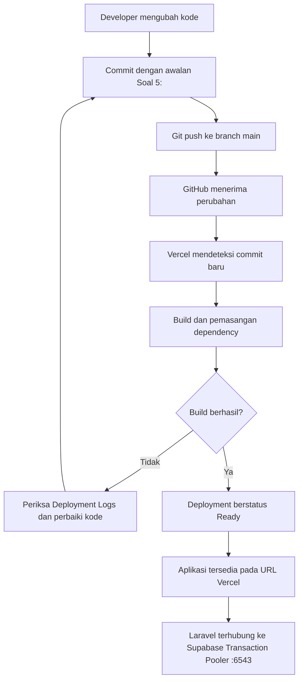

# Panduan Praktikum Modul VII — RuangBaca

Panduan ini mengikuti **Tugas Praktikum Modul VII: SPA, CI/CD, dan Deployment Aplikasi** pada enam nomor soal. Proyek tetap menggunakan Sistem Perpustakaan Digital dari Modul 1–6. Fitur aplikasi tidak diubah menjadi SPA; materi Modul VII yang diterapkan di tugas ini adalah persiapan production, Supabase, konfigurasi Vercel, deployment otomatis, dan pengujian production.

## Identitas proyek

- Nama aplikasi: **RuangBaca**
- Deskripsi: **Perpustakaan Digital**
- NIM: `250441100045`
- Database production: PostgreSQL pada Supabase
- Database lokal untuk tahap Modul VII: Session Pooler Supabase, port `5432`
- Database aplikasi di Vercel: Transaction Pooler Supabase, port `6543`

> Jangan pernah memasukkan `.env`, `APP_KEY`, password database, password seeder, atau token Vercel ke repository maupun tangkapan layar.

---

## Soal 1 — Persiapan Proyek dan Repositori GitHub

### 1.1 Jalankan dan periksa aplikasi lokal

Buka folder proyek melalui terminal Laragon:

```bash
cd C:\laragon\www\perpustakaan_250441100045x
composer install
npm ci
npm run build
php artisan optimize:clear
php artisan serve
```

Buka `http://127.0.0.1:8000`, lalu periksa login, katalog buku, dan peminjaman menggunakan akun yang sudah dibuat pada Modul 6.

### 1.2 Periksa berkas Git

Buka `.gitignore`. Pastikan `.env` diabaikan. Proyek sudah menyediakan `.env.example` yang mencantumkan nama variabel tanpa nilai rahasia. Salin `.env.example` menjadi `.env` hanya jika belum ada `.env` lokal:

```bash
copy .env.example .env
php artisan key:generate
```

Jangan menimpa `.env` lama yang masih berisi koneksi atau APP_KEY yang sedang dipakai.

### 1.3 Buat repository dan push

Buat repository kosong di GitHub, lalu jalankan dari folder proyek. Jika belum ada repository Git lokal:

```bash
git init
git branch -M main
git add .
git status
git commit -m "Soal 1: Persiapan proyek dan repository GitHub"
git remote add origin https://github.com/USERNAME/NAMA-REPOSITORY.git
git push -u origin main
```

Jika repository remote sudah terpasang, jangan menambahkan remote kedua. Periksa dengan `git remote -v`, kemudian lakukan `git add`, `git commit`, dan `git push`.

**Yang dilaporkan:** potongan `.gitignore`, isi `.env.example`, screenshot halaman login dan katalog lokal, screenshot repository GitHub yang menunjukkan daftar berkas dan URL.

**Penjelasan:** `.env` berisi konfigurasi lokal dan rahasia, sehingga tidak boleh di-commit. `.env.example` menjadi acuan nama variabel yang harus disiapkan oleh pengembang lain tanpa membocorkan nilai rahasia.

---

## Soal 2 — Menyiapkan Database Supabase

### 2.1 Buat project Supabase

1. Buat project baru di Supabase.
2. Pilih region terdekat (contoh: Southeast Asia/Singapore).
3. Simpan password database dengan aman.
4. Buka **Connect** dan salin detail **Session Pooler**: host, port, dan username. Salin host persis seperti yang ditampilkan; jangan menebak angka indeks pooler atau menyusun host hanya dari nama region.

### 2.2 Aktifkan ekstensi PostgreSQL pada PHP Laragon

Cari file `php.ini` dengan:

```bash
php --ini
```

Aktifkan baris berikut (hapus tanda titik koma di awal jika masih dikomentari):

```ini
extension=pdo_pgsql
extension=pgsql
```

Restart terminal dan layanan PHP Laragon. Periksa dengan:

```bash
php -m | findstr pgsql
```

Keluaran harus menampilkan `pdo_pgsql` dan `pgsql`.

### 2.3 Atur `.env` lokal

Gunakan **Session Pooler** port `5432`. Ganti placeholder dengan detail dari dashboard Supabase.

```env
APP_NAME=RuangBaca
APP_ENV=local
APP_DEBUG=true
APP_URL=http://127.0.0.1:8000
APP_LOCALE=id
APP_FALLBACK_LOCALE=id
APP_FAKER_LOCALE=id_ID
APP_TIMEZONE=Asia/Jakarta

DB_CONNECTION=pgsql
DB_HOST=aws-INDEX-REGION.pooler.supabase.com
DB_PORT=5432
DB_DATABASE=postgres
DB_USERNAME=postgres.PROJECT_REF
DB_PASSWORD="PASSWORD_DATABASE_SUPABASE"
DB_SSLMODE=require

SESSION_DRIVER=database
SESSION_SECURE_COOKIE=false
```

Username untuk Shared Pooler harus mengikuti format `postgres.PROJECT_REF`. Jangan menulis tanda kutip tambahan pada username. Host harus disalin persis dari **Connect** karena indeks cluster dapat berbeda antarproject. Password pada `.env` boleh diberi tanda kutip jika mengandung karakter khusus atau spasi.

### 2.4 Periksa `config/database.php`

Bagian koneksi `pgsql` harus memuat konfigurasi berikut. Pengaturan koneksi bawaan lain tetap dipertahankan.

```php
'pgsql' => [
    'driver' => 'pgsql',
    'url' => env('DB_URL'),
    'host' => env('DB_HOST', '127.0.0.1'),
    'port' => env('DB_PORT', '5432'),
    'database' => env('DB_DATABASE', 'laravel'),
    'username' => env('DB_USERNAME', 'root'),
    'password' => env('DB_PASSWORD', ''),
    'charset' => env('DB_CHARSET', 'utf8'),
    'prefix' => '',
    'prefix_indexes' => true,
    'search_path' => 'public',
    'sslmode' => env('DB_SSLMODE', 'prefer'),
    'options' => [
        PDO::ATTR_EMULATE_PREPARES => true,
    ],
],
```

`PDO::ATTR_EMULATE_PREPARES` diperlukan untuk menghindari masalah prepared statement pada Transaction Pooler. Konfigurasi ini dapat dipertahankan saat aplikasi menggunakan Session Pooler.

### 2.5 Jalankan migrasi dan seeder

Sebelum seeding ke Supabase, isi ketiga password akun seeder di `.env` lokal dengan password pribadi yang kuat dan minimal 12 karakter. `SEED_ADMIN_PASSWORD` harus menggunakan password administrator baru yang memang akan dipakai saat pengujian Modul 7; jangan biarkan kosong karena password acak tidak dapat digunakan untuk login. Jangan gunakan password contoh.

```env
SEED_ADMIN_PASSWORD=PASSWORD_ADMIN_MINIMAL_12_KARAKTER
SEED_PETUGAS_PASSWORD=PASSWORD_PETUGAS_MINIMAL_12_KARAKTER
SEED_SISWA_PASSWORD=PASSWORD_SISWA_MINIMAL_12_KARAKTER
```

Lanjutkan:

```bash
php artisan config:clear
php artisan db:show
php artisan migrate
php artisan db:seed
```

Pastikan `db:show` menunjukkan driver `pgsql`. Periksa Table Editor Supabase dan pastikan tabel serta data hasil seeder muncul. Uji login aplikasi lokal.

**Catatan:** jangan menggunakan `migrate:fresh` pada database yang berisi data penting karena perintah itu menghapus tabel lalu membuatnya kembali.

### Session Pooler dan Transaction Pooler

- **Session Pooler (5432):** digunakan untuk koneksi lokal dan perintah migrasi dari komputer pengembang.
- **Transaction Pooler (6543):** digunakan pada Vercel karena fungsi serverless membuka koneksi sesuai permintaan; pooler mengelola pemakaian koneksi agar lebih efisien.

Aktifkan Row Level Security (RLS) pada tabel-tabel di schema `public` tanpa menambahkan policy publik. Aplikasi Laravel pada praktikum ini memakai koneksi database langsung menggunakan kredensial server, bukan anon key; karena itu akses Laravel tidak bergantung pada policy Data API.

**Yang dilaporkan:** potongan `.env` tanpa APP_KEY/DB_PASSWORD/password seeder, potongan koneksi `pgsql`, screenshot `db:show`, Table Editor (daftar tabel dan isi tabel pengguna), serta aplikasi lokal yang berhasil login.

Simpan perubahan kode dan template konfigurasi (jangan sertakan `.env`) dalam commit untuk nomor ini:

```bash
git add .env.example config/database.php config/app.php database/seeders
git commit -m "Soal 2: Menyiapkan koneksi database Supabase"
git push origin main
```

---

## Soal 3 — Berkas Konfigurasi Vercel

Berkas konfigurasi deployment tersedia pada root proyek dan folder `api`.

### `api/index.php`

```php
<?php

// Vercel meneruskan permintaan aplikasi ke entry point Laravel.
require __DIR__ . '/../public/index.php';
```

### `vercel.json`

```json
{
  "version": 2,
  "functions": {
    "api/index.php": {
      "runtime": "vercel-php@0.9.0"
    },
    "api/assets.php": {
      "runtime": "vercel-php@0.9.0"
    }
  },
  "routes": [
    { "src": "/build/(.*)", "dest": "/api/assets.php?path=$1" },
    { "src": "/css/(.*)", "dest": "/css/$1" },
    { "src": "/js/(.*)", "dest": "/js/$1" },
    { "src": "/(favicon\\.ico|robots\\.txt)", "dest": "/$1" },
    { "src": "/(.*)", "dest": "/api/index.php" }
  ]
}
```

### `api/assets.php`

Berkas ini menyajikan file hasil Vite build yang berada di `public/build` melalui endpoint PHP. Runtime komunitas `vercel-php` mendukung Composer script bernama `vercel` pada fase build, tetapi file yang dihasilkan oleh script tersebut tidak otomatis tersedia sebagai aset statis browser. Karena itu, permintaan `/build/...` diarahkan ke endpoint ini. Endpoint hanya mengizinkan nama file dengan ekstensi aset yang dikenal dan memeriksa jalur fisik agar tidak dapat membaca file di luar `public/build`.

### `.vercelignore`

```gitignore
.env
.env.*
!.env.example
/vendor
/node_modules
/.git
/.vercel
/tests
/database/database.sqlite
/storage/logs
```

Fungsi berkas:
- `api/index.php`: titik masuk yang meneruskan request aplikasi ke Laravel.
- `api/assets.php`: menyajikan aset hasil build Vite dengan pembatasan jalur file.
- `vercel.json`: menentukan runtime PHP dan mengarahkan aset build serta halaman aplikasi.
- `.vercelignore`: mengecualikan berkas lokal dan rahasia yang tidak boleh diunggah. `.env` harus tetap diabaikan; variabel production dimasukkan melalui pengaturan Vercel.

### Proses build frontend otomatis di Vercel

`composer.json` menyediakan script bernama `vercel` yang menjalankan perintah berikut pada fase build runtime PHP komunitas:

```json
"vercel": [
  "npm ci",
  "npm run build"
]
```

Runtime `vercel-php` mendukung pemanggilan Composer script bernama `vercel` pada fase build. Dengan demikian, dependency frontend dipasang dari `package-lock.json`, lalu Vite mengompilasi aset ke `public/build`. Aturan `/build/(.*)` pada `vercel.json` meneruskan aset hasil kompilasi agar dapat dimuat browser. Jangan menghapus script tersebut tanpa mengganti proses build dengan konfigurasi build yang setara.

Commit perubahan:

```bash
git add api/index.php api/assets.php vercel.json .vercelignore
git commit -m "Soal 3: Menambahkan konfigurasi deployment Vercel"
git push origin main
```

**Yang dilaporkan:** isi `api/index.php`, `api/assets.php`, `vercel.json`, dan `.vercelignore`; screenshot repository GitHub yang memperlihatkan keempat berkas; serta penjelasan fungsi masing-masing.

---

## Soal 4 — Deploy Aplikasi ke Vercel

### 4.1 Import repository

1. Masuk ke Vercel dengan akun GitHub.
2. Import repository RuangBaca.
3. Pastikan root directory menunjuk ke folder yang berisi `composer.json`, `package.json`, dan `vercel.json`.

### 4.2 Tambahkan Environment Variables

Pada **Project → Settings → Environment Variables**, daftarkan variabel berikut untuk environment **Production**:

| Key | Value | Keterangan |
|---|---|---|
| `APP_NAME` | `RuangBaca` | Nama aplikasi. |
| `APP_ENV` | `production` | Lingkungan production. |
| `APP_KEY` | hasil `php artisan key:generate --show` | Kunci enkripsi aplikasi; rahasiakan. |
| `APP_DEBUG` | `false` | Menyembunyikan detail error dari pengguna. |
| `APP_URL` | URL project Vercel, misalnya `https://nama-project.vercel.app` | URL production. |
| `APP_LOCALE` | `id` | Bahasa aplikasi. |
| `APP_FALLBACK_LOCALE` | `id` | Bahasa cadangan. |
| `APP_FAKER_LOCALE` | `id_ID` | Locale data Faker. |
| `APP_TIMEZONE` | `Asia/Jakarta` | Zona waktu aplikasi. |
| `DB_CONNECTION` | `pgsql` | Driver PostgreSQL. |
| `DB_HOST` | host Transaction Pooler Supabase | Salin persis dari menu Connect, termasuk indeks cluster dan region. |
| `DB_PORT` | `6543` | Port Transaction Pooler. |
| `DB_DATABASE` | `postgres` | Nama database Supabase. |
| `DB_USERNAME` | `postgres.PROJECT_REF` | Username sesuai project reference Supabase. |
| `DB_PASSWORD` | password database Supabase | Rahasiakan. |
| `DB_SSLMODE` | `require` | Koneksi database menggunakan SSL. |
| `SESSION_DRIVER` | `database` | Sesi disimpan di tabel `sessions`. |
| `SESSION_SECURE_COOKIE` | `true` | Cookie sesi hanya dikirim melalui HTTPS. |
| `CACHE_STORE` | `database` | Cache disimpan di tabel `cache` dan `cache_locks`. |
| `LOG_CHANNEL` | `stderr` | Catatan aplikasi tampil pada Vercel Logs. |
| `VIEW_COMPILED_PATH` | `/tmp/ruangbaca/views` | Lokasi sementara hasil kompilasi Blade yang dapat ditulis. |

`APP_KEY` dapat dibuat dari root proyek lokal:

```bash
php artisan key:generate --show
```

Salin hasilnya langsung ke Vercel. Jangan mengirimkannya melalui chat atau memasukkannya ke GitHub. `DB_HOST`, username, dan password mengikuti detail project Supabase. Gunakan **Transaction Pooler**, bukan Session Pooler.

Variabel tambahan melengkapi konfigurasi production untuk lingkungan serverless: cache disimpan di database, log diarahkan ke standard error agar terlihat pada Vercel Logs, berkas tampilan Blade sementara diarahkan ke `/tmp`, dan cookie sesi dibatasi untuk HTTPS. `config/view.php` membaca `VIEW_COMPILED_PATH`; di lingkungan lokal variabel tersebut boleh dikosongkan agar Laravel memakai lokasi bawaan. Untuk localhost, `SESSION_SECURE_COOKIE=false`; untuk Vercel HTTPS, gunakan `true`.

`api/index.php` menyiapkan folder hasil kompilasi Blade pada `/tmp/ruangbaca/views` sebelum memanggil Laravel. `config/view.php` juga menggunakan folder tersebut sebagai nilai bawaan ketika `APP_ENV=production`. Di lokal, Laravel tetap menggunakan folder `storage/framework/views`.

### 4.3 Deploy dan verifikasi

Klik **Deploy** dan tunggu status menjadi **Ready**. Buka URL `.vercel.app` dan login dengan akun seeder. Jika environment variable diubah, jalankan Redeploy karena perubahan hanya diterapkan pada deployment baru.

Periksa **Deployment Logs** jika ada error. Catat error, penyebab, dan perbaikannya untuk laporan.

**Yang dilaporkan:** daftar environment variable dengan nilai rahasia disembunyikan, screenshot deployment Ready, URL Vercel, halaman login, serta halaman setelah login.

Catat URL Vercel dan status deployment pada README proyek (URL bersifat publik, tetapi jangan menuliskan APP_KEY atau password), kemudian commit catatan tersebut:

```bash
git add README.md docs/modul7/README_MODUL7.md
git commit -m "Soal 4: Mencatat hasil deployment production"
git push origin main
```

---

## Soal 5 — Alur Deploy Otomatis dan Diagramnya

Ubah teks kecil pada halaman login, misalnya teks identitas NIM. Perubahan contoh pada proyek ini dapat dilakukan pada `resources/views/auth/login.blade.php`; NIM sudah ditampilkan di bagian identitas login.

Untuk membuktikan trigger otomatis, ubah bagian teks tersebut sedikit (contoh: tambahkan kata `Praktikum Modul VII`), lalu simpan dan jalankan:

```bash
git add resources/views/auth/login.blade.php
git commit -m "Soal 5: Memperbarui identitas halaman login"
git push origin main
```

**Jangan menekan tombol Deploy secara manual.** Repository yang sudah terhubung akan memicu deployment otomatis pada Vercel. Buka tab **Deployments**, amati deployment baru dari status Building sampai Ready, lalu periksa URL production dan pastikan teks terbaru tampil.

### Diagram alur



### Perbedaan CI dan CD

- **CI (Continuous Integration):** integrasi perubahan kode secara rutin dan pemeriksaan otomatis agar perubahan tidak merusak aplikasi.
- **CD (Continuous Deployment/Delivery):** kelanjutan proses yang menyiapkan atau merilis hasil build ke lingkungan tujuan. Pada praktikum ini, bagian CD terlihat saat push ke branch utama memicu build dan deployment otomatis Vercel sampai status Ready.

**Yang dilaporkan:** potongan teks sebelum/sesudah perubahan, screenshot commit `Soal 5:` dan deployment otomatis Building/Ready, halaman sebelum/sesudah perubahan beserta URL, perbedaan CI dan CD, serta bagian alur yang termasuk CD.

---

## Soal 6 — Pengujian Aplikasi di Production

Semua skenario harus diuji melalui **URL Vercel**, bukan localhost. Isi kolom hasil aktual berdasarkan pengujian nyata; jangan menyalin hasil yang diharapkan jika belum diuji.

| No. | Role | Skenario | Hasil yang diharapkan | Hasil aktual |
|---:|---|---|---|---|
| 1 | Belum login | Membuka URL utama aplikasi | Halaman aplikasi tampil tanpa pesan galat | Isi setelah diuji |
| 2 | Belum login | Membuka `/peminjaman/1` | Dialihkan ke halaman login | Isi setelah diuji |
| 3 | Administrator | Login dengan akun administrator dan kata sandi baru | Berhasil masuk | Isi setelah diuji |
| 4 | Administrator | Login dengan akun administrator dan kata sandi `password` | Login ditolak | Isi setelah diuji |
| 5 | Administrator | Menambah buku dengan judul berisi NIM `250441100045` | Buku tampil di daftar dan tercatat pada Table Editor Supabase | Isi setelah diuji |
| 6 | Administrator | Mengubah lalu menghapus buku tersebut | Perubahan dan penghapusan berhasil | Isi setelah diuji |
| 7 | Siswa | Login lalu membuka daftar buku | Daftar tampil; tombol Tambah, Ubah, dan Hapus tidak tampil | Isi setelah diuji |
| 8 | Siswa | Membuka `/buku/create` secara langsung | `403 Forbidden` | Isi setelah diuji |
| 9 | Siswa | Membuka peminjaman milik sendiri | `200`, data tampil | Isi setelah diuji |
| 10 | Siswa | Membuka peminjaman milik siswa lain | `403 Forbidden` | Isi setelah diuji |
| 11 | Petugas | Membuka peminjaman milik siswa mana pun | `200`, data tampil | Isi setelah diuji |
| 12 | Semua | Membuka `/.env` | `404` atau `403` | Isi setelah diuji |
| 13 | Semua | Membuka alamat tidak ada, misalnya `/halaman-tidak-ada` | Halaman `404` umum tanpa jejak kode | Isi setelah diuji |

Jika ada hasil yang tidak sesuai:
1. Catat URL, role, hasil aktual, dan pesan error (jangan mencatat rahasia).
2. Cari penyebab melalui Vercel Logs dan kode aplikasi.
3. Perbaiki di lokal, uji ulang, lalu commit dengan awalan `Soal 6:`.
4. Push ke branch utama, tunggu deployment otomatis, dan ulangi skenario yang gagal.

**Yang dilaporkan:** perbaikan source code (atau tulis “tidak ada perubahan” jika memang tidak ada), hasil aktual 13 skenario, screenshot setiap hasil dengan URL dan status yang terlihat, serta perbandingan perilaku lokal dan production.

Isi template `docs/modul7/hasil-pengujian-production.md` berdasarkan hasil nyata dari URL Vercel. Lampirkan screenshot pada laporan praktikum resmi, lalu simpan perbaikan kode dan catatan hasil pengujian tanpa memasukkan data rahasia:

```bash
git add app routes resources docs/modul7/hasil-pengujian-production.md
git commit -m "Soal 6: Menyelesaikan pengujian aplikasi production"
git push origin main
```

---

## Checklist akhir pengumpulan

- [ ] Repository GitHub berisi source code dan `.env.example`, tetapi tidak berisi `.env`.
- [ ] Ada commit untuk Soal 1 sampai Soal 6 dengan awalan pesan sesuai nomor.
- [ ] Supabase menerima migrasi dan data seeder.
- [ ] Environment Variables Vercel terisi pada Production dan nilai rahasia disembunyikan pada screenshot.
- [ ] Deployment Vercel berstatus Ready.
- [ ] Push GitHub memicu deployment otomatis tanpa menekan Deploy manual.
- [ ] Seluruh 13 pengujian production sudah dilakukan dan hasil aktual dicatat.
- [ ] Laporan berisi source code, hasil/screenshot, penjelasan, tautan GitHub, dan URL Vercel.

## Catatan runtime PHP pada Vercel

Saat panduan ini diperbarui pada **16 November 2026**, paket npm `vercel-php` masih menampilkan versi `0.9.0`, dan dokumentasi runtime komunitas menampilkan konfigurasi `"runtime": "vercel-php@0.9.0"`. Dokumentasi paket mencantumkan PHP 8.5 dan Node.js 22.x. Runtime ini adalah runtime komunitas. Pemeriksaan paket juga mengonfirmasi bahwa Composer dapat menjalankan script bernama `vercel` pada fase build; file aset yang dibuat script tersebut dapat digunakan oleh fungsi PHP tetapi tidak otomatis dapat diakses browser. Karena itu proyek menyediakan `api/assets.php` untuk menyajikan aset hasil Vite build. [Paket npm](https://www.npmjs.com/package/vercel-php) · [Dokumentasi runtime komunitas](https://github.com/vercel-community/php).


## Standar Istilah Antarmuka RuangBaca

Agar label pada seluruh halaman konsisten, proyek menggunakan istilah berikut:

| Konteks | Istilah baku |
|---|---|
| Nama aplikasi | RuangBaca |
| Deskripsi aplikasi | Perpustakaan Digital |
| Peran admin | Administrator |
| Peran petugas | Petugas |
| Peran siswa | Siswa |
| Menu katalog | Katalog Buku |
| Menu transaksi | Peminjaman |
| Riwayat siswa | Riwayat Peminjaman |
| Data pengguna | Pengguna |
| Tanggal transaksi | Tanggal Peminjaman / Tanggal Pengembalian |
| Status belum diproses | Menunggu Persetujuan |
| Status sudah diterima | Disetujui |
| Status ditolak | Ditolak |
| Status selesai | Dikembalikan |
| Tanggal kosong | Belum dikembalikan |
| Data buku hilang | Buku tidak tersedia |
| Kategori kosong | Tanpa kategori |

Judul halaman dan tombol memakai kapitalisasi judul. Kalimat penjelas memakai kapitalisasi kalimat. Tanggal ditampilkan dalam format `d F Y` dan angka menggunakan pemisah ribuan Indonesia (`.`). Halaman publik, autentikasi, dashboard tiap peran, katalog, transaksi, laporan, pengguna, profil, dan pesan validasi mengikuti bahasa Indonesia.
